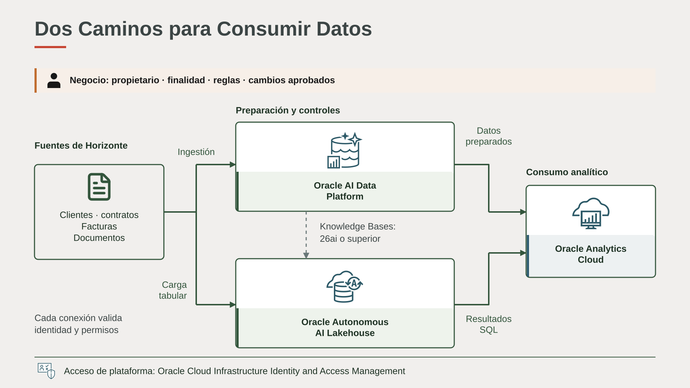
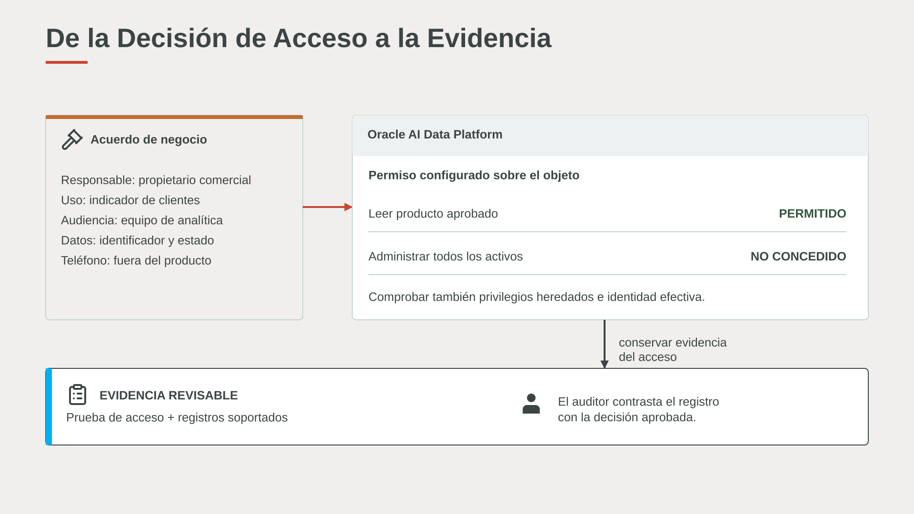
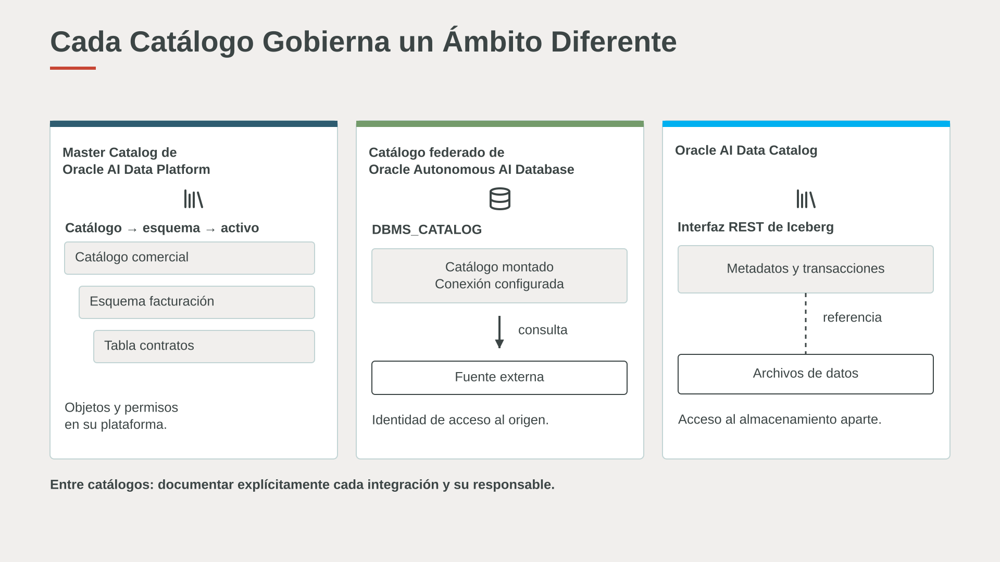

Usa esta matriz para pasar de una necesidad del dominio DAMA a una acción con Oracle: identifica al responsable, elige la capacidad y define la evidencia del resultado. Una misma decisión puede combinar procesos, personas y varios controles técnicos. Los enlaces oficiales permiten profundizar en la configuración y el uso de cada función.

## Arquitectura Conceptual y Tecnológica

El plano conceptual comienza con un **producto de datos**: clientes y contratos aptos para facturación, indicadores y atención autorizada. Define propietario, finalidades, esquema, reglas de calidad, frecuencia, consumidores y procedimiento de cambio. Las fuentes conservan sus responsabilidades. La autorización del producto analítico no sustituye las políticas de los sistemas operacionales.

En el plano tecnológico, **Oracle AI Data Platform** organiza activos, ejecución, permisos y evidencias de ingeniería. **Oracle Autonomous AI Lakehouse** aporta procesamiento SQL, datos analíticos e integración con formatos abiertos. Conectores, credenciales, red y formatos determinan cada relación; las flechas representan caminos que deben configurarse y validarse. Knowledge Bases, Agent Flows y AI Compute de Oracle AI Data Platform requieren una instancia de Oracle Autonomous AI Lakehouse 26ai o superior, según los [requisitos de las funciones de IA](https://docs.oracle.com/en/cloud/paas/ai-data-platform/aidug/get-started-oracle-ai-data-platform.html). La ingestión y transformación de datos estructurados pueden utilizarse sin habilitar esas funciones.

Oracle Cloud Infrastructure GoldenGate se añade cuando se necesita captura de cambios. Data Studio de Oracle Autonomous AI Database y Oracle Data Transforms permiten explorar y preparar datos en su ámbito. Oracle Analytics Cloud consume datasets con semántica revisada. Oracle Data Safe aplica a bases de datos soportadas; Oracle Fusion Cloud Enterprise Data Management es una aplicación SaaS con sus propios requisitos. Oracle Cloud Infrastructure Identity and Access Management, claves, almacenamiento y observabilidad sostienen controles concretos, no una autorización global que se propague a todo.

## Matriz de Decisiones y Evidencia

Lee cada fila como una aplicación: qué necesita el negocio, quién decide y cómo se implementa. Por ejemplo, una finalidad aprobada se convierte en permisos sobre un producto, pruebas de acceso y registros de auditoría.

| Área DAMA | Necesidad | Responsable | Aplicación con Oracle |
| --- | --- | --- | --- |
| Gobierno de Datos | Asignar acceso a activos y revisar decisiones | Propietario del dato administrador | Oracle AI Data Platform: roles y permisos de objetos; la aprobación de finalidad sigue siendo organizativa  <strong>Documentación oficial:</strong><ul class="official-sources"><li>[Modelo de permisos](https://docs.oracle.com/en/cloud/paas/ai-data-platform/aidug/permissions-model.html)</li></ul> |
| Gobierno de Datos | Comprobar quién operó un activo | Auditor | Oracle AI Data Platform: registros de auditoría de operaciones soportadas  <strong>Documentación oficial:</strong><ul class="official-sources"><li>[Audit log](https://docs.oracle.com/en/cloud/paas/ai-data-platform/aidug/audit-log.html)</li></ul> |
| Arquitectura de Datos | Separar preparación de consumo SQL | Arquitecto | Oracle AI Data Platform + Oracle Autonomous AI Lakehouse; conexiones y prerrequisitos explícitos  <strong>Documentación oficial:</strong><ul class="official-sources"><li>[Oracle AI Data Platform](https://docs.oracle.com/en/cloud/paas/ai-data-platform/aidug/overview-oracle-ai-data-platform.html)</li><li>[modalidades de Oracle Autonomous AI Database](https://docs.oracle.com/en/cloud/paas/autonomous-database/serverless/adbsb/about-autonomous-database-workloads.html)</li></ul> |
| Modelado de Datos y Diseño | Definir entidades y semántica analítica | Modelador negocio | Tablas y vistas en Oracle Autonomous AI Database; vistas analíticas para medidas y dimensiones  <strong>Documentación oficial:</strong><ul class="official-sources"><li>[Data Analysis](https://docs.oracle.com/en/cloud/paas/autonomous-database/serverless/adbsb/data-analysis-tool.html)</li></ul> |
| Modelado de Datos y Diseño | Publicar términos y medidas compartidos | Modelador propietario del dato | Oracle Analytics Cloud Semantic Modeler: relacionar tablas, definir cardinalidad y agregaciones y publicar el modelo de consumo  <strong>Documentación oficial:</strong><ul class="official-sources"><li>[Crear un modelo semántico](https://docs.oracle.com/en/cloud/paas/analytics-cloud/acmdg/workflow-build-semantic-model.html)</li><li>[relaciones lógicas](https://docs.oracle.com/en/cloud/paas/analytics-cloud/acmdg/logical-joins.html)</li></ul> |
| Almacenamiento de Datos y Operaciones | Retener objetos según una política | Responsable documental operaciones | Oracle Cloud Infrastructure Object Storage: reglas de retención; distinguirlas de versiones y lifecycle  <strong>Documentación oficial:</strong><ul class="official-sources"><li>[Retention rules](https://docs.oracle.com/en-us/iaas/Content/Object/Tasks/usingretentionrules.htm)</li></ul> |
| Almacenamiento de Datos y Operaciones | Detectar desvíos y atribuir gasto | Operaciones FinOps | Métricas, Cost Analysis de Oracle Cloud Infrastructure y presupuestos; las alertas de presupuesto no cortan el consumo  <strong>Documentación oficial:</strong><ul class="official-sources"><li>[Oracle Cloud Infrastructure Monitoring](https://docs.oracle.com/en-us/iaas/Content/Monitoring/Concepts/monitoringoverview.htm)</li><li>[Cost Analysis de Oracle Cloud Infrastructure](https://docs.oracle.com/en-us/iaas/Content/Billing/Concepts/costanalysisoverview.htm)</li><li>[Budgets de Oracle Cloud Infrastructure](https://docs.oracle.com/en-us/iaas/Content/Billing/Tasks/create-budget.htm)</li></ul> |
| Seguridad de Datos | Separar identidades y material criptográfico | Seguridad plataforma | Oracle Cloud Infrastructure Identity and Access Management y Oracle Cloud Infrastructure Key Management Service; permisos de plataforma y dato deben revisarse por separado  <strong>Documentación oficial:</strong><ul class="official-sources"><li>[Oracle Cloud Infrastructure Identity and Access Management](https://docs.oracle.com/en-us/iaas/Content/Identity/Concepts/overview.htm)</li><li>[Oracle Cloud Infrastructure Key Management Service](https://docs.oracle.com/en-us/iaas/Content/KeyManagement/Concepts/keyoverview.htm)</li></ul> |
| Seguridad de Datos | Descubrir PII y preparar copias de prueba | Seguridad DBA | Oracle Data Safe: descubrir atributos sensibles, configurar subsetting y masking en una copia registrada y revisar relaciones e informes  <strong>Documentación oficial:</strong><ul class="official-sources"><li>[Oracle Data Safe](https://docs.oracle.com/en-us/iaas/data-safe/doc/oracle-data-safe-overview.html)</li><li>[Data Subsetting](https://docs.oracle.com/en-us/iaas/data-safe/doc/data-subsetting-overview.html)</li></ul> |
| Seguridad de Datos | Clasificar y proteger datos con revisión humana | Steward seguridad | Implementar un flujo sobre Oracle AI Data Platform: clasificar atributos, aprobar tratamientos, generar vistas protegidas o copias enmascaradas y comprobar permisos  <strong>Documentación oficial:</strong><ul class="official-sources"><li>[Flujo de protección de datos sensibles](https://blogs.oracle.com/cloud-infrastructure/aidp-sensitive-data-governance)</li></ul> |
| Integración de Datos e Interoperabilidad | Capturar cambios con menor latencia | Ingeniería de datos | Oracle Cloud Infrastructure GoldenGate: conexión con Oracle AI Data Platform cuando origen, destino y patrón son compatibles  <strong>Documentación oficial:</strong><ul class="official-sources"><li>[Conexión Oracle Cloud Infrastructure GoldenGate](https://docs.oracle.com/en-us/iaas/releasenotes/goldengate/r9connections.htm)</li></ul> |
| Integración de Datos e Interoperabilidad | Preparar datos y coordinar dependencias | Ingeniería de datos | Workflows de Oracle AI Data Platform y Oracle Data Transforms en sus ámbitos; anotaciones y asistencia de IA con configuración propia  <strong>Documentación oficial:</strong><ul class="official-sources"><li>[Workflows](https://docs.oracle.com/en/cloud/paas/ai-data-platform/aidug/workflows.html)</li><li>[versiones de Oracle Data Transforms](https://docs.oracle.com/en/database/data-integration/data-transforms/releasenotes/whats-new-oracle-data-transforms.html)</li></ul> |
| Gestión de Documentos y Contenido | Recuperar conocimiento autorizado para IA | Propietario documental | Knowledge Bases de Oracle AI Data Platform: ingestión y recuperación de contenido soportado; conservar política de vigencia  <strong>Documentación oficial:</strong><ul class="official-sources"><li>[Knowledge Bases](https://docs.oracle.com/en/cloud/paas/ai-data-platform/aidug/knowledge-bases.html)</li></ul> |
| Datos Maestros y de Referencia | Aprobar cambios y resolver duplicados | Data steward propietario | Oracle Fusion Cloud Enterprise Data Management: match/merge y reglas de supervivencia; evaluar dominio, escala y requisitos SaaS  <strong>Documentación oficial:</strong><ul class="official-sources"><li>[Survivorship](https://docs.oracle.com/en/cloud/saas/enterprise-data-management-cloud/dmcaa/matching_create_survivorship_rules.html)</li></ul> |
| Data Warehousing e Inteligencia de Negocio | Publicar indicadores consistentes | Responsable de BI | Oracle Autonomous AI Lakehouse + Oracle Analytics Cloud; conexión con Oracle AI Data Platform documentada  <strong>Documentación oficial:</strong><ul class="official-sources"><li>[Conectar Oracle Analytics Cloud con Oracle AI Data Platform](https://docs.oracle.com/en/cloud/paas/analytics-cloud/acsds/connect-ai-data-platform.html)</li></ul> |
| Data Warehousing e Inteligencia de Negocio | Asistir preparación y consultas analíticas | Analista administrador Oracle Analytics Cloud | Habilitar AI Assistant para generar columnas y expresiones en data flows; usar MCP para descubrir fuentes, consultar metadatos y ejecutar ANSI SQL, revisando filtros y resultados  <strong>Documentación oficial:</strong><ul class="official-sources"><li>[AI Assistant en flujos de datos](https://docs.oracle.com/en/cloud/paas/analytics-cloud/acubi/use-ai-assistant-create-data-flows.html)</li><li>[Descubrimiento y consultas con MCP](https://docs.oracle.com/en/cloud/paas/analytics-cloud/acsdv/discover-data-run-query-workflow-preview.html)</li></ul> |
| Gestión de Metadatos | Encontrar y gestionar activos de Oracle AI Data Platform | Steward ingeniería | Master Catalog de Oracle AI Data Platform  <strong>Documentación oficial:</strong><ul class="official-sources"><li>[Master Catalog de Oracle AI Data Platform](https://docs.oracle.com/en/cloud/paas/ai-data-platform/aidug/manage-master-catalog.html)</li></ul> |
| Gestión de Metadatos | Analizar dependencias y cambios | Ingeniería propietario | Linaje de Oracle AI Data Platform de entidades y columnas y análisis de impacto en artefactos soportados; último registro por proceso  <strong>Documentación oficial:</strong><ul class="official-sources"><li>[Linaje e impacto](https://docs.oracle.com/en/cloud/paas/ai-data-platform/aidug/lineage.html)</li></ul> |
| Gestión de Metadatos | Consultar fuentes mediante catálogos montados | Arquitecto DBA | Catálogo federado de Oracle Autonomous AI Database; montaje y acceso mediante DBMS_CATALOG  <strong>Documentación oficial:</strong><ul class="official-sources"><li>[DBMS_CATALOG](https://docs.oracle.com/en/database/oracle/oracle-database/26/arpls/dbms_catalog.html)</li></ul> |
| Gestión de Metadatos | Compartir metadatos transaccionales Iceberg | Plataforma lakehouse | Oracle AI Data Catalog: servicio REST administrado dentro de Oracle Autonomous AI Database, distinto de Master Catalog de Oracle AI Data Platform  <strong>Documentación oficial:</strong><ul class="official-sources"><li>[Oracle AI Data Catalog](https://docs.oracle.com/en/cloud/paas/autonomous-database/serverless/adbsb/oracle-ai-data-catalog.html)</li></ul> |
| Gestión de Metadatos | Enriquecer descripciones y revisar impacto | Steward | Data Studio de Oracle Autonomous AI Database: exploración y linaje soportado; Oracle Data Transforms: anotaciones empresariales y ayuda de IA  <strong>Documentación oficial:</strong><ul class="official-sources"><li>[Explorar el catálogo](https://docs.oracle.com/en/cloud/paas/autonomous-database/data-studio-guide/explore-data-catalog.html)</li><li>[anotaciones](https://docs.oracle.com/en/database/data-integration/data-transforms/using/view-and-manage-annotations.html)</li></ul> |
| Calidad de Datos | Aceptar, rechazar y corregir por reglas de negocio | Propietario ingeniería | Oracle AI Data Platform: ejecutar comprobaciones SQL en notebooks, coordinar validación y publicación con workflows y registrar los rechazos  <strong>Documentación oficial:</strong><ul class="official-sources"><li>[Workflows](https://docs.oracle.com/en/cloud/paas/ai-data-platform/aidug/workflows.html)</li></ul> |

## Tres Catálogos y una Responsabilidad Común

**Master Catalog de Oracle AI Data Platform** organiza activos de Oracle AI Data Platform. El **catálogo federado de Oracle Autonomous AI Database** organiza el acceso a fuentes mediante montajes. **Oracle AI Data Catalog** implementa la interfaz REST de Iceberg para metadatos de tablas y transacciones. El acceso al almacenamiento es una comprobación adicional. Ninguno de estos nombres demuestra que los tres se repliquen entre sí.

En Horizonte, cada conexión registra origen, identidad efectiva, objetos expuestos, permisos, actualización y responsable. Si se necesita compartir un término empresarial entre herramientas, se define su identificador, versión y proceso de publicación; no se da por resuelto al habilitar un catálogo.

El linaje ayuda a localizar consumidores de un cambio, pero no sustituye un registro histórico de aprobaciones. Una sugerencia de IA puede enriquecer una descripción; el steward valida su significado antes de publicarla. La solución debe demostrar la cadena completa: **decisión → control → ejecución → evidencia → revisión**.
